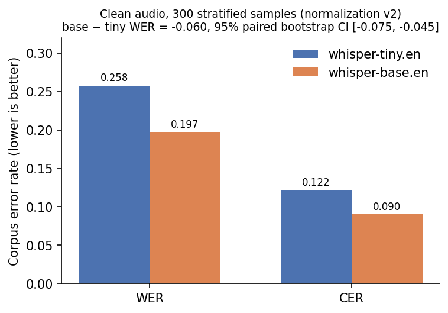
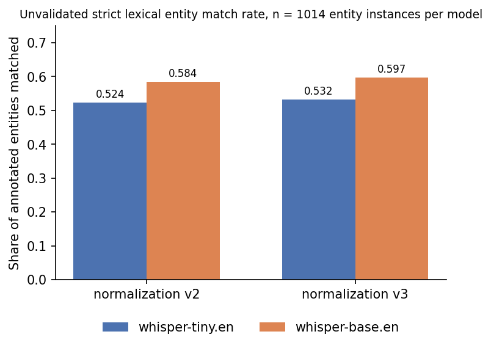
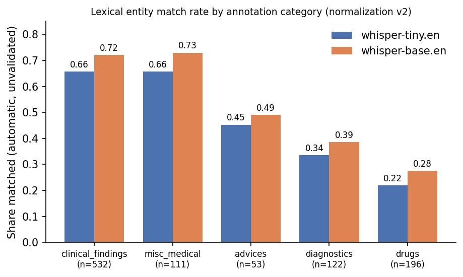
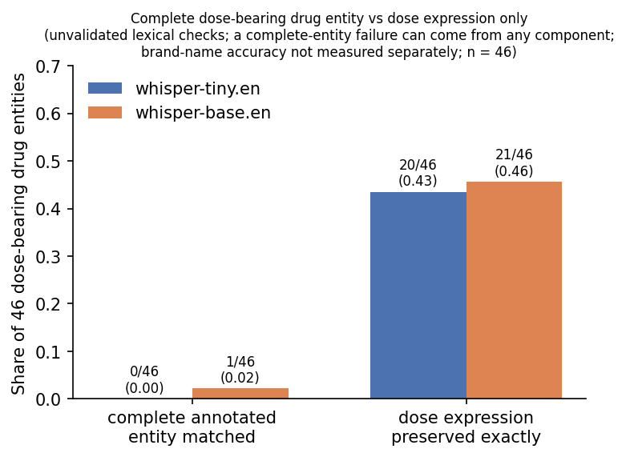
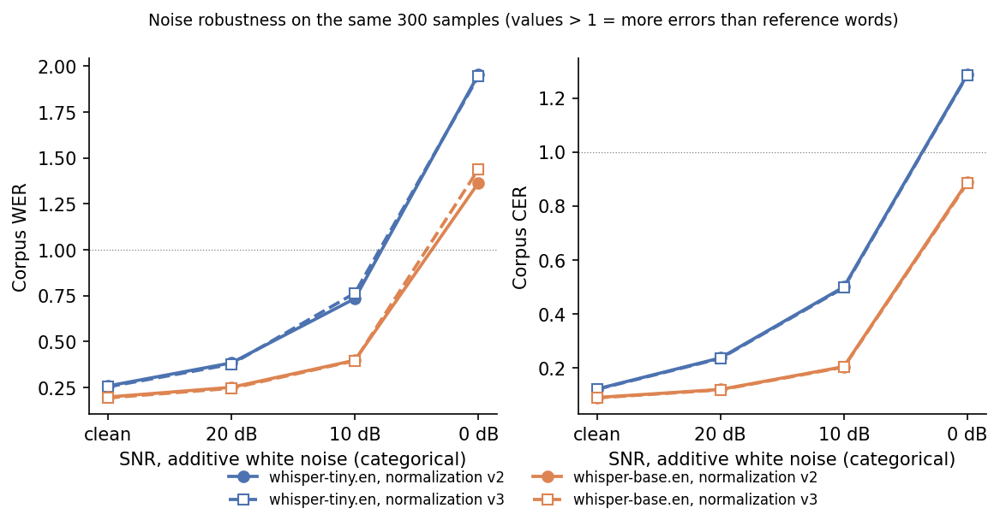
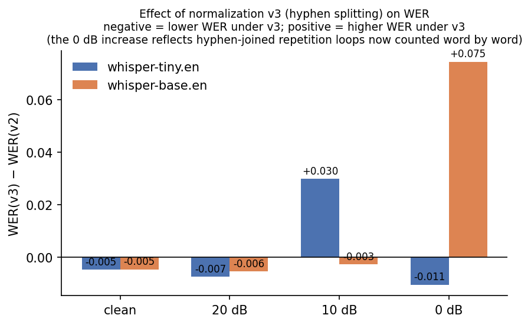
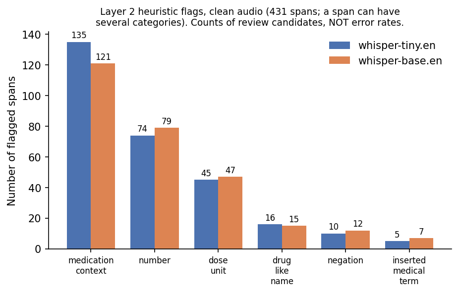
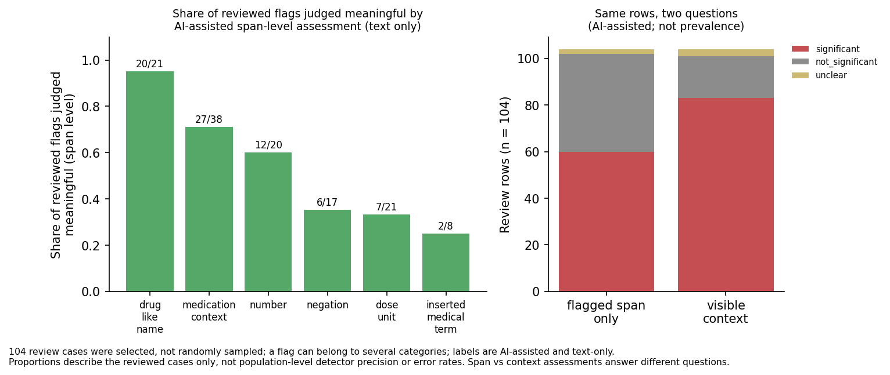
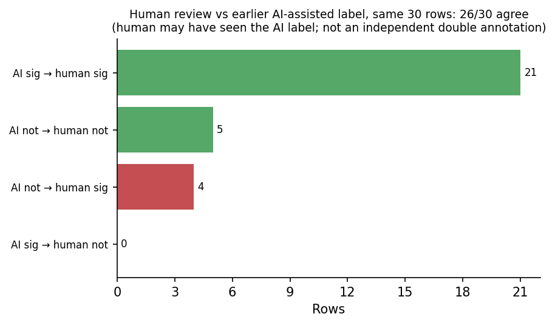

# ClinASR: Evaluating Medical Speech Recognition Beyond Word Error Rate Through Entity Preservation and Critical Transcription Error Analysis

*Exploratory benchmark. Not a clinical system; no claim of clinical safety or clinical validation is made.*

All numbers in this report are recomputed from saved experiment outputs by
`scripts/collect_final_results.py` and stored in `docs/final_results.json`, which also records the
SHA-256 of every source file. Figures are drawn from that file by `scripts/make_figures.py`.

---

## Abstract

**Problem.** Word error rate (WER) treats every word equally, but in clinical speech a misheard drug
name, dose, or negation matters far more than a misheard article. We ask how much of that distinction a
WER-centred evaluation captures for pretrained speech recognizers on Indian-English medical speech.

**Models and data.** We evaluate two pretrained, off-the-shelf models — `openai/whisper-tiny.en` and
`openai/whisper-base.en` — by inference only (no fine-tuning) on the evaluation-only
`ekacare/eka-medical-asr-evaluation-dataset` (English test split, 3,619 utterances, 8.4 h), using a fixed,
stratified 300-utterance subset (47.7 min) selected before any model was run.

**Method.** We report corpus WER/CER under declared, versioned text normalizations; paired bootstrap
confidence intervals; a lexical check of annotated medical entities and of dose expressions; robustness to
additive white noise at 20/10/0 dB SNR; and a second, review-oriented layer that flags candidate critical
discrepancies (numbers, units, negation, medication names, inserted medical terms) from word alignments.
Flags were reviewed with text-only labels: 30 by a human reviewer, the remainder AI-assisted (OpenAI GPT-6).

**Findings.** (1) whisper-base.en has lower WER than whisper-tiny.en on clean audio (0.197 vs 0.258;
paired difference −0.060, 95% CI [−0.075, −0.045]) and in every one of nine strata. (2) Both models have
much higher error on the isolated-term strata than on the sentence strata (e.g. drug-name-only utterances:
WER 1.028 / 0.729 vs 0.149 / 0.113 for drug sentences); these strata differ in more than sentence context,
so this is a descriptive, not causal, comparison. (3) base.en degrades less under noise (+0.200 vs +0.476 WER
at 10 dB). Under severe noise both models emit long repetition loops, making WER exceed 1 and making the
0 dB comparison depend on how hyphens are normalized. (4) Whole-entity lexical matching cannot isolate dose
preservation: of 46 dose-bearing drug entities, the complete annotated entity matched 0 (tiny) and 1 (base)
times, while the dose expression evaluated separately was reproduced exactly 20 and 21 times. (5) WER does
not show which discrepancies matter: on a selected 104-row review sample, AI-assisted text-only span-level
assessment judged automatically flagged drug-like-name spans meaningful in 20 of 21 cases but dose-unit
flags in only 7 of 21 (descriptive for the reviewed cases, not a detector precision estimate).

**Contribution and limits.** A reproducible, two-layer evaluation (lexical entity preservation + reviewed
candidate discrepancies) with explicit annotation provenance. Limits: two small English models, one
stratified subset, synthetic white noise only, text-only review without audio, mostly AI-assisted labels,
and no clinician review.

---

## 1. Introduction and Motivation

Medical dictation and clinical conversation are hard for speech recognition: drug brand names are rare
in general training data and often look like ordinary words to a language model ("Losartar" → "Losator",
"isoflurane" → "Eyes up your lane"); doses mix numbers and units in many spoken forms ("500 mg",
"five hundred milligram"); and negation ("without surgery") flips meaning with one word. Errors of this
kind have been documented in real speech-recognition-assisted clinical documents [9].

WER [8] counts substitutions, deletions and insertions relative to the reference length. It is a good
summary of overall accuracy but weights "the" → "a" exactly like "500 mg" → "5 g", and depends on
normalization choices that are rarely reported. For medical use, the questions that matter are narrower:
*were the medication names, doses and negations transcribed correctly?* This project asks how far a
standard WER/CER evaluation answers those questions, and what a lightweight, reproducible complement
looks like.

## 2. Technical Background

**Automatic speech recognition.** An ASR system maps an audio waveform to text. Modern systems are
end-to-end neural networks trained on paired audio and transcripts.

**Whisper.** Whisper [1] is an encoder–decoder Transformer [2] trained on ~680k hours of weakly
supervised web audio. Audio is resampled to 16 kHz, cut or padded to 30-second windows, and converted to
an 80-channel log-Mel spectrogram; the encoder processes the spectrogram and the decoder generates text
tokens autoregressively, conditioned on special task tokens. The `.en` checkpoints are English-only.
`whisper-tiny.en` (~39M parameters) and `whisper-base.en` (~74M parameters) are the two smallest sizes.
We used them through the Hugging Face Transformers pipeline [3].

**WER and CER.** WER = (S + D + I) / N over words after normalization, where N is the number of reference
words; CER is the same over characters. Because insertions are counted, WER can exceed 1 when a system
produces more erroneous words than the reference contains. We compute *corpus* WER (summed edits over
summed reference length), not a mean of per-utterance WERs. Implementation: `jiwer`.

**Medical entity preservation.** Given annotated entities (e.g. "azithromycin", "500 mg") with
character offsets in the reference, we ask whether each entity appears in the hypothesis. This is a
lexical question and must be distinguished from whether the *meaning in context* is preserved.

**Noise robustness.** Additive noise at a target signal-to-noise ratio (SNR) is a controlled way to test
how quickly accuracy degrades; it is not a model of real clinical acoustic environments.

## 3. Research Objectives and Hypotheses

- **O1 / H1 (model size).** The larger model (base.en) has lower WER/CER than tiny.en on the same audio.
- **O2 / H2 (terminology).** Errors concentrate on isolated medical terms (drug names, diagnostics) more
  than on full sentences.
- **O3 / H3 (noise).** WER rises with decreasing SNR, and the larger model degrades less.
- **O4 / H4 (metric adequacy).** WER/CER and whole-entity matching do not distinguish clinically salient
  errors (drug names, doses, negation) from benign variation; a targeted review layer separates them better.

These were stated as working expectations before the stratified runs; they were not formally
pre-registered.

## 4. Dataset and Experimental Setup

**Dataset.** `ekacare/eka-medical-asr-evaluation-dataset` [6], config `en`, split `test`, Hub revision
`433e66037c8aebb8f396b938624a5ab6afc4ca36`. Evaluation only — never used for training or to construct
prompts. A full scan of all records (no audio decoding) found:

| Property | Value |
|---|---|
| Utterances | 3,619 (3,524 distinct `session_id`; `file_name` unique) |
| Total audio | 8.4 h (median clip 4.9 s, max 29.99 s, none > 30 s) |
| Annotation status | 3,561 ok, 48 partial, 10 empty, 0 missing/malformed |
| Annotated entities | 10,661 in 5 categories (clinical_findings 5,615; drugs 2,504; misc_medical 1,145; diagnostics 1,021; advices 376) |
| Offsets | 10,585 present, all align exactly with the reference text; 76 entities have empty offsets |
| Utterances with a drug entity | 1,931; 681 contain a dose-like drug entity (heuristic) |

The `medical_entities` field is a JSON-encoded string of `[text, category, [[start, end], ...]]`
entries. There is no dosage category; doses appear inside drug entities. `speaker` was empty in the
audited records and was not used.

**Subset.** 300 utterances stratified by `recording_context` × `type_concept` (9 strata), at least 20
per stratum and the rest allocated proportionally (largest remainder). Within a stratum, utterances are
ranked by SHA-256 of `seed:file_name` (seed 20261029) — no random-number generator — so the selection is
identical on any machine and Python version. The selection fingerprint
(`8b345d92…`) was computed locally and checked inside each GPU run before inference.
The subset deliberately over-samples small strata: **its overall numbers are not population estimates.**

| Stratum (recording_context × type_concept) | Selected / population |
|---|---|
| narration_entity × drugs | 58 / 1,097 |
| narration_entity × clinical_findings | 49 / 852 |
| narration_sentence × drugs | 43 / 669 |
| narration_sentence × misc_medical | 29 / 286 |
| narration_sentence × diagnostics | 28 / 238 |
| narration_entity × advices | 26 / 201 |
| conversation × misc_medical | 23 / 110 |
| narration_sentence × clinical_findings | 23 / 110 |
| narration_entity × diagnostics | 21 / 56 |

`narration_entity` utterances are short recordings of an isolated term or phrase (e.g. a drug name);
`narration_sentence` utterances are full sentences.

**Models.** `openai/whisper-tiny.en` @ `87c7102498dcde7456f24cfd30239ca606ed9063` and
`openai/whisper-base.en` @ `911407f4214e0e1d82085af863093ec0b66f9cd6` [7], pinned by Hub revision.

**Environment.** Kaggle notebook, NVIDIA Tesla T4 (confirmed in each run's `environment.json`), Python
3.13, torch 2.11.0+cu128, transformers 5.16.1, datasets 4.8.5, torchcodec 0.11.0, jiwer 4.0.0 (versions
read from the running environment, not assumed).

**Reproducibility controls.** Pinned dataset and model revisions; deterministic selection with a
fingerprint check that aborts the run on mismatch; greedy decoding; per-run directories with manifests and
git commit; a single-file Kaggle script generated from tested source modules; 176 unit tests. The clean
condition of the noise run reproduced the Stage 2 clean WER/CER exactly (a determinism check across two
separate GPU jobs).

## 5. Methodology

**Inference.** Audio decoded at 16 kHz; Transformers ASR pipeline; greedy decoding (`num_beams=1`,
`do_sample=False`); batch 16; fp16 on CUDA. Both models receive identical audio.

**Normalization (applied identically to reference and hypothesis).**

| Version | Rule set | Status |
|---|---|---|
| v1 | NFKC; lowercase; strip punctuation except between digits (keeps "2.5", "1/2", "1-0-1"); collapse spaces; numbers never rewritten | Used for the original Stage 2 report; reproducible |
| v2 | v1 + split a number from an attached dose unit ("400mg" → "400 mg") | **Primary** for reported results |
| v3 | v2 + hyphen → word break, except digit ranges ("6-8") and minus signs ("-5"); Unicode dashes mapped first | Sensitivity analysis |

v2 was introduced after Stage 2 revealed "400mg" vs "400 mg" being counted as errors; v3 after
annotation review revealed that the ASCII hyphen had never been in the punctuation set. Both are
declared as new versions and applied to saved hypotheses; no hypothesis is ever edited, and earlier
versions stay reproducible. Number words are never converted to digits ("two" ≠ "2"), which is a
deliberately conservative choice that raises WER on dose-heavy utterances.

**WER/CER.** Corpus-level via `jiwer`, overall and per stratum. Empty references are excluded and
counted; missing hypotheses are scored as complete deletions.

**Paired comparison.** Both models are scored on the same 300 utterances. A paired bootstrap [4, 5]
resamples utterances with replacement (2,000 resamples, seed 0), recomputes each model's corpus WER from
summed counts, and reports the 2.5th–97.5th percentile of the difference. Intervals describe this subset
only.

**Entity evaluation (Layer 1, lexical).** Each annotated entity in a reference is labelled *exact*
(appears verbatim as a token sequence in the raw hypothesis), *normalized* (appears after normalization)
or *omitted*. Matching is on whole tokens, so "50" does not match inside "150mg". Layer 1 measures
**lexical preservation of each annotated entity in isolation**; it does not judge meaning in context and
cannot see unannotated words. Its labels are reported as an unvalidated *match rate*, not recall.

**Dose evaluation.** For entities containing a number + dose unit, `dose_preserved` checks each dose
expression (e.g. "75 mg", "10 mg") separately from the brand name. Strict: spoken forms
("grams per deciliter") and unit-less strengths ("Dolo 650") are not reconciled.

**White-noise augmentation.** Gaussian white noise scaled to 20, 10 and 0 dB SNR, seeded per
(utterance, condition) so both models hear identical noisy audio. Silent or very short clips are left
unchanged and logged; if adding noise pushed the waveform outside [−1, 1] it was peak-renormalized
(9 / 17 / 40 clips at 20 / 10 / 0 dB), identically for both models.

**Layer 2 candidate discrepancies.** Reference and hypothesis are aligned word by word (`jiwer`). Every
non-matching span is flagged if it touches: a number; a dose unit; a negation word; medication context
(within two words of "tablet", "capsule", "syrup", "injection", or a dose unit); a drug-like suffix
(e.g. -mycin, -pril, -sartan, -statin); or an inserted medical term from a short, explicit list. Flags
are review candidates, never errors by themselves.

**Annotation procedures and provenance.**

| Annotation set | Labels | Who |
|---|---|---|
| Layer 1 review, 150 entity rows (stratified 25 per model × automatic label) | preserved / not_preserved / unclear | AI-assisted (OpenAI GPT-6), following written rules |
| Layer 2 review, 104 flagged spans (stratified by model × category; clean audio) — overall label | significant / not_significant / unclear (text-only discrepancy, not clinical significance) | **30 rows: human reviewer** (verified against the uploaded review file); 74 rows: AI-assisted (GPT-6) |
| Layer 2 review — span-level and context-level labels | same, separately for the flagged span and for the visible context | AI-assisted (GPT-6) for all 104 |

No clinician reviewed any label and no audio was replayed during review.

## 6. Results and Analysis

### 6.1 Clean-audio comparison

| Normalization | WER tiny | WER base | CER tiny | CER base | base − tiny WER [95% CI] |
|---|---|---|---|---|---|
| v1 (original) | 0.2665 | 0.2035 | 0.1228 | 0.0909 | −0.0630 [−0.0778, −0.0480] |
| **v2 (primary)** | **0.2577** | **0.1974** | **0.1219** | **0.0903** | **−0.0603 [−0.0753, −0.0455]** |
| v3 | 0.2528 | 0.1926 | 0.1204 | 0.0888 | −0.0601 [−0.0744, −0.0463] |

Per utterance (v2): base.en lower WER on 157, tiny.en on 44, tied on 99. The conclusion does not depend
on normalization version.

**By stratum (v2, WER tiny / base):**

| Stratum | n | WER tiny | WER base | CER tiny | CER base |
|---|---|---|---|---|---|
| narration_sentence × clinical_findings | 23 | 0.137 | 0.108 | 0.051 | 0.041 |
| narration_sentence × drugs | 43 | 0.149 | 0.113 | 0.059 | 0.040 |
| narration_sentence × misc_medical | 29 | 0.155 | 0.110 | 0.090 | 0.067 |
| conversation × misc_medical | 23 | 0.260 | 0.214 | 0.149 | 0.124 |
| narration_sentence × diagnostics | 28 | 0.309 | 0.279 | 0.158 | 0.139 |
| narration_entity × advices | 26 | 0.510 | 0.375 | 0.249 | 0.190 |
| narration_entity × clinical_findings | 49 | 0.864 | 0.506 | 0.356 | 0.208 |
| narration_entity × drugs | 58 | 1.028 | 0.729 | 0.452 | 0.279 |
| narration_entity × diagnostics | 21 | 1.094 | 0.891 | 0.551 | 0.364 |

base.en is lower in all nine strata. Isolated-term utterances (`narration_entity`) have 3–7× higher WER than
sentence utterances of the same concept type. This is a descriptive difference between strata: the strata
also differ in vocabulary, length and recording style, so it does not establish that sentence context
itself causes the gap. WER above 1 on drug-name-only clips is real: references are one to
four words, and the models replace an unfamiliar name with a longer English phrase
("isoflurane" → "Eyes up your lane." from tiny.en), so insertions exceed the reference length. CER is the more stable
view for these strata. Per-stratum n is 21–58, so stratum estimates are imprecise.

### 6.2 Entity preservation (Layer 1: unvalidated strict lexical match rates)

1,014 annotated entity instances per model in the 300 utterances.

| Category (n) | tiny v2 | base v2 | tiny v3 | base v3 |
|---|---|---|---|---|
| All (1,014) | 0.524 | 0.584 | 0.532 | 0.597 |
| clinical_findings (532) | 0.658 | 0.722 | 0.665 | 0.731 |
| misc_medical (111) | 0.658 | 0.730 | 0.667 | 0.739 |
| advices (53) | 0.453 | 0.491 | 0.453 | 0.491 |
| diagnostics (122) | 0.336 | 0.385 | 0.344 | 0.410 |
| drugs (196) | 0.219 | 0.276 | 0.230 | 0.296 |

These are **unvalidated strict lexical match rates**, not measures of true entity preservation. The
matcher requires the annotated tokens to appear in sequence, so it misses semantically equivalent
expressions, abbreviations, inflections ("disease" / "diseases"), spelling variants and spoken forms
("milligram per deciliter" for "mg/dL"). Drug entities are matched far less often than clinical findings,
consistent with H2. In the 150-row AI-assisted comparison (7.3), the matcher's "preserved" agreed with the
labels in 99 of 100 rows and its "omitted" in 37 of 50; that study is not independent human or clinical
validation.

### 6.3 Medication and dose results

46 drug entities per model contain an explicit dose (number + unit).

| | tiny v2 | base v2 | tiny v3 | base v3 |
|---|---|---|---|---|
| Complete annotated entity matched | 0 / 46 | 1 / 46 | 0 / 46 | 1 / 46 |
| Dose expression preserved exactly | 20 / 46 (0.435) | 21 / 46 (0.457) | 21 / 46 (0.457) | 24 / 46 (0.522) |

The two checks measure different things. A complete dose-bearing entity (e.g. "Voage 5mg Tablet") fails
whole-entity matching if *any* component differs — the medication name, spelling, formulation word, word
order or the dose — so a whole-entity failure is not evidence that the brand name specifically was wrong
(e.g. "Voage 5mg Tablet" → "Vogue 5mg tablet" fails on the name while its dose is intact). Brand-name
accuracy was not measured separately. **Whole-entity lexical matching cannot isolate dosage preservation;
evaluating the dose expression separately reveals information obscured by whole-entity matching.**
n = 46 is small; these figures are descriptive.

### 6.4 Noise robustness

| Condition | WER tiny | WER base | CER tiny | CER base | base − tiny WER [95% CI] |
|---|---|---|---|---|---|
| clean | 0.258 | 0.197 | 0.122 | 0.090 | −0.060 [−0.075, −0.045] |
| 20 dB | 0.383 | 0.250 | 0.237 | 0.120 | −0.133 [−0.263, −0.064] |
| 10 dB | 0.734 | 0.398 | 0.500 | 0.205 | −0.336 [−0.596, −0.144] |
| 0 dB | 1.954 | 1.364 | 1.286 | 0.889 | −0.590 [−1.119, −0.084] |

(v2.) WER increase relative to clean, paired [95% CI]:

| | 20 dB | 10 dB | 0 dB |
|---|---|---|---|
| tiny.en | +0.126 [0.057, 0.251] | +0.476 [0.284, 0.739] | +1.696 [1.281, 2.180] |
| base.en | +0.053 [0.040, 0.067] | +0.200 [0.176, 0.226] | +1.166 [0.815, 1.561] |

base.en's point estimate of degradation is lower at every level (H3); at 20 and 10 dB the base − tiny
interval excludes zero under both normalizations. At 0 dB it excludes zero under v2 but not under v3
(§6.6), so no decisive model advantage is claimed at 0 dB. The very wide intervals for tiny.en come from a
few utterances where it produced very long hallucinated output.

### 6.5 Important failure cases (verbatim from outputs)

- **Medication names (examples):** "Losartar 50 Tablet" → "Losator 50 tablet" (base) / "Losato 50 tablet" (tiny);
  "glimepiride" → "glemuparide" (base); "treosulfan" → "Rios Alfan." (base) / "3O cell fan" (tiny);
  "Calpol" → "calpal" (base); "isoflurane" → "Eyes up your lane." (tiny) / "Isopurin" (base).
- **Dose:** "Glisen-PM 1mg/500mg/15mg Tablet" → "Listen PM1MG by 5G by 15MG tablet" (tiny; 500 mg → 5 g),
  while base.en kept "500MG".
- **Negation:** "conservatively followed up without surgery" → "… followed up with surgery" (both models)
  — the entity "surgery" is lexically present, so Layer 1 scores it preserved.
- **Inserted term:** "Take Zincovit once in a day" → "takes in COVID once in a day" (smoke test) — a
  disease term the speaker never said.
- **Severe noise:** repetition loops such as "extra-glass-free-to-side-no-no-no-no-…".

### 6.6 Sensitivity to normalization

On clean audio v3 lowers WER by ~0.005 for both models and changes no conclusion. Under noise it can
*raise* WER (base.en at 0 dB: 1.364 → 1.438): hyphen-joined repetition loops were a single token under v2
and are now counted word by word, so v2 under-counted hallucinated output. At 0 dB under v3 the
base − tiny interval includes zero (−0.505 [−1.027, +0.014]); the 0 dB comparison is therefore not robust
to normalization, while clean, 20 dB and 10 dB comparisons are.

## 7. Critical-Error Analysis

### 7.1 Why WER alone is insufficient here

A WER of 0.197 says nothing about *which* words were wrong. The same utterance can have low WER and a
reversed negation, or high WER from harmless spelling variants. Section 6.3 already shows one blind spot
of a coarser entity metric; the review below describes, for a selected set of flagged cases, which
discrepancy types were judged meaningful at the text level.

Four kinds of evidence appear in this section and are kept separate: **automatically flagged candidate
discrepancies** (heuristic output, not errors), **AI-assisted text-level assessments**, **human-reviewed
overall transcription assessments** (30 rows), and **clinically validated errors — of which there are
none** in this study.

### 7.2 Layer 2 candidates

Clean audio, both models: **431 flagged spans** (tiny 221, base 210; 327 substitutions, 69 insertions,
35 deletions). 101 of them lie outside every annotated entity: these are **candidate discrepancies outside
the annotated entity coverage** — places Layer 1 cannot examine — not automatically verified errors. The
detector proposes cases for examination; it does not establish transcription or clinical correctness. Counts by
category (a span can carry several): medication context 135 / 121, number 74 / 79, dose unit 45 / 47,
drug-like name 16 / 15, negation 10 / 12, inserted medical term 5 / 7 (tiny / base). The flagger
reproduces the known cases (Losartar → Losator, without → with). These are counts of review candidates,
not error rates. Across the noise run the flag count rises from 431 (clean) to 663 at 0 dB.

### 7.3 Layer 1 agreement with AI-assisted labels

150 entity rows (stratified, not representative) labelled with AI assistance (OpenAI GPT-6):
observed agreement **90.7%**, Cohen's κ [10] = **0.777**.

| | labels: preserved | labels: not_preserved |
|---|---|---|
| matcher: preserved | 99 | 1 |
| matcher: not_preserved | 13 | 37 |

Per class (matcher vs labels): preserved P/R/F1 0.990 / 0.884 / 0.934; not_preserved 0.740 / 0.974 /
0.841. The matcher is too strict rather than too lenient: of 13 "omitted but preserved" rows, 3 are the
hyphen bug fixed by v3, 9 are spelling/inflection/spoken-form variants, 1 is ambiguous. Excluding the two
flagged rows (#29 contextual negation, #57 ambiguous "radiograph"/"radiography"): 91.9%, κ 0.805; with
automatic labels recomputed under v3: 92.7%, κ 0.820. This measures agreement with AI-assisted labels,
not independent human validation.

### 7.4 Flagged span versus visible context

The 104-row Layer 2 review (cases selected for review, not randomly sampled) separates two questions: is
the **flagged span** itself a meaningful text discrepancy, and does **any medically relevant information in
the visible context** differ (case-study judgement)? They disagree on 24 rows — typically a harmless trigger
("mg/dL" → "milligram per deciliter") next to a distorted term ("urea" → "eurya").

Span level (AI-assisted, text only; n = 102 decided, 2 unclear): 60 / 102 (0.588) of the reviewed flags
judged meaningful. By category (categories overlap): drug-like name 20 / 21, medication context 27 / 38,
number 12 / 20, negation 6 / 17, dose unit 7 / 21, inserted medical term 2 / 8. These proportions describe
the reviewed cases; they are not population-level detector precision.
Context level: 83 significant, 18 not, 3 unclear; 71 of 89 unique (utterance, model) pairs have at least one. **Neither figure is an error
prevalence**: the sample was priority/stratified-selected, several rows share an utterance, labels are
AI-assisted, and nothing is clinically validated.

### 7.5 Human-reviewed labels

30 overall labels were assigned by a human reviewer (25 significant, 5 not significant), verified against
the uploaded review file. On those same 30 rows an earlier AI-assisted pass had agreed on 26; all 4
changes were from not_significant to significant (e.g. "5-6" → "6", "milligram" → "mg"), i.e. the human
reviewer was stricter. The reviewer may have seen the AI labels, so this is not an independent
double-annotation study.

### 7.6 Disagreements, false positives and false negatives

- **False positives of the flagger:** spelling variants ("gynaecological" → "gynecological"), unit
  expansions, number words ("6" → "six"). Dose-unit and inserted-term flags had the lowest share judged
  meaningful among the reviewed cases.
- **False negatives:** drug names without a known suffix and not next to a form word; contextual errors
  that do not touch a flagged token type; anything outside the flagged categories.
- **Layer 1 vs context:** "surgery" is lexically preserved while its negation is reversed (row #29). We
  keep the original label and record the negation as a Layer 2 candidate (flagged, and judged significant
  at the text level); the two layers are complementary.
- **Spreadsheet corruption:** saving the human-review file through Excel converted "5-6" into the date
  "05-Jun"; imports therefore take only label columns from reviewer files and validate all raw text against
  the generated originals.

## 8. Discussion

**Model size.** base.en roughly doubles the parameters of tiny.en and is consistently better on clean
audio and markedly more robust to noise. In encoder–decoder ASR, a larger decoder carries a stronger
language model; a plausible explanation (not tested here) is that this helps on fluent sentences and under
noise, while the same prior pulls rare drug names toward common English words. Both models have their
highest error on isolated drug names; the gap between strata (WER 0.73–1.03 vs 0.11–0.15) is larger than the
gap between models. Lack of sentence context is one candidate explanation, but the strata also differ in
vocabulary and recording style, so this comparison does not isolate the effect of context.

**Harmless versus meaningful differences.** Many WER errors are benign: spelling variants, singular/plural,
hyphenation, "6" vs "six", "mg" vs "milligram". Others change meaning with a single token: a drug name, a
dose, a negation. WER weights both equally, and whole-entity matching cannot tell a changed dose from a
change elsewhere in the entity. In the reviewed cases (AI-assisted, text-level), drug-like-name and
medication-context flags were usually judged meaningful discrepancies and dose-unit flags usually were not
(unit expansions such as "mg" → "milligram"); a changed dose number (500 mg → 5 g) is a meaningful text
discrepancy, though its clinical severity was not assessed.

**Severe noise.** At 0 dB both models hallucinate: long repetition loops and invented text. WER then
mostly measures output length, and its value depends on tokenization choices such as hyphen handling.
Reporting both normalizations and the CER makes this visible instead of hiding it.

**Trade-offs.** On this data the larger model has lower error on every accuracy measure we computed, with
the 0 dB comparison as the exception that is not robust to normalization. Runtime, throughput and latency
were not benchmarked (the runs recorded only single, un-warmed timings of the transcription call), so no
efficiency trade-off is reported. The decisive limitation for medical use is terminology, which neither small
general-domain model handles well.

## 9. Limitations and Future Work

- One stratified 300-utterance subset; small strata over-sampled; overall numbers are not population
  estimates, and per-stratum n is 21–58.
- Two small English Whisper checkpoints, inference only; no fine-tuning, no larger or medical-domain models.
- Additive white Gaussian noise only; no babble, reverberation or real clinical recordings.
- Few explicit dose annotations (46 dose-bearing entities in the subset); dose-only checks are strict and
  ignore spoken forms and unit-less strengths.
- Text-only review: no audio replay, so reference transcription errors cannot be adjudicated.
- No clinician validation; "significant" means a meaningful text discrepancy, not clinical significance.
- 30 human-reviewed overall labels; the 74 remaining overall labels and all 104 span/context labels and the
  150 Layer 1 labels are AI-assisted (GPT-6). Agreement with AI-assisted labels is not validation.
- Lexical, whole-token entity matching (no synonyms, abbreviations or number-word reconciliation); 76
  annotated entities have no offsets and may not be verbatim in the reference.
- Layer 2 heuristics are hand-written; they over-flag unit expansions and miss unusual drug names.
- Hallucination and repetition at low SNR make WER depend on normalization.
- Runtime and latency were not benchmarked.

**Future work:** larger and medical-domain ASR models; domain adaptation on separately licensed training
data; realistic noise and room acoustics; clinician-adjudicated review with audio; a drug lexicon (e.g.
standard drug vocabularies) instead of suffix rules; number-word and unit normalization as a declared
version; multilingual evaluation on the dataset's non-English configurations.

## 10. Conclusion

On this stratified sample of Indian-English medical speech, whisper-base.en is more accurate and more
noise-robust than whisper-tiny.en (with the 0 dB comparison sensitive to normalization), but both have
their highest error on the content that matters for clinical use: drug names and isolated medical terms.
WER captures the model ranking but not the nature of the errors; whole-entity lexical matching cannot
isolate dose preservation, which a separate dose check reveals; and discrepancies such as a reversed
negation are invisible to both. A second, review-oriented layer that flags candidate discrepancies in
numbers, doses, negation and medication names — reviewed with explicit annotation provenance — gives a more
informative picture at low cost. Its flags are candidates, its reviews are text-level and mostly
AI-assisted, and none of this constitutes clinical validation.

## References

1. A. Radford, J. W. Kim, T. Xu, G. Brockman, C. McLeavey, I. Sutskever. *Robust Speech Recognition via
   Large-Scale Weak Supervision.* arXiv:2212.04356, 2022.
2. A. Vaswani et al. *Attention Is All You Need.* arXiv:1706.03762, 2017.
3. T. Wolf et al. *Transformers: State-of-the-Art Natural Language Processing.* EMNLP 2020: System
   Demonstrations. doi:10.18653/v1/2020.emnlp-demos.6
4. B. Efron. *Bootstrap Methods: Another Look at the Jackknife.* The Annals of Statistics, 1979.
   doi:10.1214/aos/1176344552
5. P. Koehn. *Statistical Significance Tests for Machine Translation Evaluation.* EMNLP 2004.
6. Eka Care. *eka-medical-asr-evaluation-dataset* (dataset card).
   https://huggingface.co/datasets/ekacare/eka-medical-asr-evaluation-dataset (revision 433e6603…)
7. OpenAI. *whisper-tiny.en* and *whisper-base.en* (model cards). https://huggingface.co/openai/whisper-tiny.en,
   https://huggingface.co/openai/whisper-base.en
8. A. C. Morris, V. Maier, P. Green. *From WER and RIL to MER and WIL: improved evaluation measures for
   connected speech recognition.* Interspeech 2004. doi:10.21437/interspeech.2004-668
9. L. Zhou et al. *Analysis of Errors in Dictated Clinical Documents Assisted by Speech Recognition
   Software and Professional Transcriptionists.* JAMA Network Open, 2018. doi:10.1001/jamanetworkopen.2018.0530
10. J. Cohen. *A Coefficient of Agreement for Nominal Scales.* Educational and Psychological Measurement,
    1960. doi:10.1177/001316446002000104
11. Q. Lhoest et al. *Datasets: A Community Library for Natural Language Processing.* EMNLP 2021: System
    Demonstrations. doi:10.18653/v1/2021.emnlp-demo.21

Bibliographic records for [1]–[5] and [8]–[11] were checked against OpenAlex/arXiv; [6]–[7] are
documentation pages.
